# Схема базы данных (Supabase Postgres)

Миграции — `supabase/migrations/*.sql`, типы — `npm run db:types`, тесты RLS — `supabase/tests/*.sql` (pgTAP).
`0000_drop_v1.sql` удаляет таблицы v1 из того же проекта Supabase. Текстовый контент — JSONB `{ "lt": "...", "ru": "..." }`, `lt` обязателен (CHECK).

## ER-диаграмма

```mermaid
erDiagram
  stores ||--o{ store_products : sells
  stores ||--o{ scrape_runs : "collected by"
  stores ||--o{ csv_imports : "imported into"
  store_products ||--o{ price_history : "price over time"
  store_products ||--o{ price_anomalies : "flagged"
  ingredients ||--o{ ingredient_synonyms : "also called"
  ingredients ||--o{ ingredient_store_matches : "matched to"
  store_products ||--o{ ingredient_store_matches : "matches"
  recipes ||--o{ recipe_ingredients : contains
  ingredients ||--o{ recipe_ingredients : "used in"
  profiles ||--o| questionnaires : "answers (health data)"
  profiles ||--o{ household_members : "eats with"
  profiles ||--o{ meal_plans : plans
  meal_plans ||--o{ plan_meals : "day × slot"
  recipes ||--o{ plan_meals : "cooked as"
  meal_plans ||--o{ baskets : "priced as"
  stores ||--o{ baskets : "at"
  baskets ||--o{ basket_lines : lines
  store_products ||--o{ basket_lines : "bought as"
  profiles ||--o{ favorites : likes
  recipes ||--o{ favorites : "liked"
  profiles ||--o{ pantry_leftovers : "has at home"
  profiles ||--o| subscriptions : "pays via Stripe"
  profiles ||--o{ ai_requests : asks
  demo_personas ||--o{ meal_plans : "demo plan"

  stores {
    text code PK "barbora | rimi"
    text name
    text source_type "eshop_scraper | csv_import | none"
    text status
    text url
    jsonb user_note "i18n"
    bool is_active
    int sort
  }
  store_products {
    uuid id PK
    text store_code FK
    text external_id
    text url
    text title "as in store"
    text brand
    numeric pack_size
    text pack_unit "g | ml | pcs"
    numeric price "EUR incl. PVM"
    numeric unit_price "per kg / l"
    numeric promo_price
    date promo_from
    date promo_to
    bool promo_loyalty
    bool in_stock
    timestamptz checked_at "NOT NULL"
    text source "NOT NULL: scraper:barbora | csv:<file>"
    jsonb allergens_declared "from product label, null = unknown"
  }
  price_history {
    bigint id PK
    uuid product_id FK
    numeric price
    numeric promo_price
    bool in_stock
    timestamptz checked_at
    text source
  }
  price_anomalies {
    bigint id PK
    uuid product_id FK
    text kind "jump_gt_50 | disappeared | parse_error"
    numeric old_price
    numeric new_price
    text status "open | approved | rejected"
    uuid resolved_by
  }
  scrape_runs {
    bigint id PK
    text store_code FK
    timestamptz started_at
    timestamptz finished_at
    int read_ok
    int read_failed
    int changed
    text log
  }
  csv_imports {
    bigint id PK
    text store_code FK
    text file_name
    jsonb preview
    text status "previewed | applied | rolled_back"
    uuid created_by
  }
  ingredients {
    text slug PK
    jsonb name "lt, ru"
    text category
    text default_unit
    numeric piece_g "1 svogūnas ≈ 100 g"
    numeric density
    text_array allergens "14 EU + lactose"
    text_array diet_tags
    numeric kcal_100g
    numeric protein_100g
    numeric fat_100g
    numeric carbs_100g
    numeric fiber_100g
    text usda_fdc_id
    text availability_level "both_stores | missing"
  }
  ingredient_synonyms {
    bigint id PK
    text ingredient_slug FK
    text locale
    text term "pg_trgm index"
  }
  ingredient_store_matches {
    bigint id PK
    text ingredient_slug FK
    uuid product_id FK
    int priority
    numeric match_confidence
    bool verified_by_admin
  }
  recipes {
    uuid id PK
    text slug UK
    jsonb title
    jsonb description
    jsonb steps "array of {lt, ru}"
    int servings
    int time_active_min
    int time_total_min
    text difficulty
    text_array equipment
    text meal "breakfast | lunch | dinner | snack"
    text cuisine
    text_array season
    bool kid_friendly
    text photo "dish photo or category placeholder"
    bool is_public "about 300 fully public"
    text source "ai:<model>@<prompt_version> | licence"
    text status "draft | auto_checked | reviewed | rejected"
    uuid reviewed_by
  }
  recipe_ingredients {
    uuid recipe_id FK
    text ingredient_slug FK
    numeric grams
  }
  profiles {
    uuid id PK "auth.users"
    text locale
    text role "user | admin"
    timestamptz health_consent_at
    bool monday_email
  }
  questionnaires {
    uuid user_id PK
    jsonb answers "goal, body, activity, budget, diet, allergies, dislikes, store, meals, cook time"
    timestamptz updated_at
  }
  household_members {
    uuid id PK
    uuid user_id FK
    text kind "adult | child"
    int age
    jsonb body "optional"
  }
  meal_plans {
    uuid id PK
    uuid user_id FK "null for demo"
    text demo_persona FK
    date week_start
    text status "active | archived"
    jsonb targets "kcal, macros per person"
  }
  plan_meals {
    uuid plan_id FK
    int day "0-6"
    text slot
    uuid recipe_id FK
    numeric servings
    bool locked
  }
  baskets {
    uuid id PK
    uuid plan_id FK
    text store_code FK
    numeric total
    timestamptz computed_at
  }
  basket_lines {
    uuid basket_id FK
    uuid product_id FK
    text ingredient_slug
    numeric grams_needed
    int packs
    numeric line_price
    text source "copied from product"
    timestamptz checked_at "copied from product"
  }
  favorites {
    uuid user_id FK
    uuid recipe_id FK
  }
  pantry_leftovers {
    uuid user_id FK
    text ingredient_slug FK
    numeric grams
    date since
  }
  subscriptions {
    uuid user_id PK
    text stripe_customer_id
    text stripe_subscription_id
    text plan "monthly | quarterly | lifetime"
    text status "trialing | active | past_due | canceled | none"
    timestamptz trial_end
    timestamptz current_period_end
    bool cancel_at_period_end
  }
  payment_events {
    text stripe_event_id PK
    text type
    timestamptz received_at
  }
  ai_requests {
    bigint id PK
    uuid user_id FK "null for guests"
    text kind "assistant | recipe_gen | translate"
    text model
    text prompt_version
    jsonb parsed "Zod-validated params, no name/email"
    int input_tokens
    int output_tokens
    numeric cost_eur
  }
  events {
    bigint id PK
    timestamptz at
    text name "pageview | cta_*"
    text path
    text visitor "daily-rotating hash"
    text device
    text ref
  }
  admin_audit {
    bigint id PK
    uuid admin_id
    text action
    jsonb details
    timestamptz at
  }
  demo_personas {
    text code PK "studentas | pora | seima"
    jsonb params
    timestamptz recomputed_at
  }
```

## Правила доступа (RLS)

| Таблицы | Чтение | Запись |
|---|---|---|
| `stores`, `ingredients`, `ingredient_synonyms`, `recipes` (только `auto_checked`/`reviewed`), `recipe_ingredients`, `demo_personas`, демо `meal_plans`/`baskets` | все | только service role / admin |
| `store_products`, `price_history` | все (цены публичные) | только service role / admin |
| `profiles`, `questionnaires`, `household_members`, `meal_plans`, `plan_meals`, `baskets`, `basket_lines`, `favorites`, `pantry_leftovers` | владелец (`auth.uid()`) | владелец |
| `subscriptions`, `payment_events` | владелец читает свою подписку | только Stripe-вебхук (service role) |
| `price_anomalies`, `scrape_runs`, `csv_imports`, `ingredient_store_matches`, `ai_requests`, `events`, `admin_audit` | admin | service role / admin |

## Инварианты (проверяются CHECK-ограничениями и тестами)
- `store_products.checked_at` и `source` — NOT NULL; в корзину берутся строки с `checked_at > now() - 14 days` и без открытой аномалии.
- `basket_lines` копирует `source` и `checked_at` товара на момент расчёта.
- Рецепт со статусом `auto_checked`/`reviewed` ссылается только на ингредиенты `availability_level = both_stores`.
- КБЖУ, аллергены, диеты и цена порции — только вычисляемые (представление `recipe_facts`), вручную не хранятся.
- `questionnaires` нельзя создать без `profiles.health_consent_at`.
